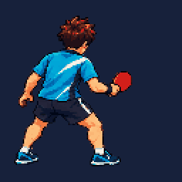
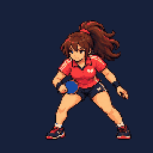
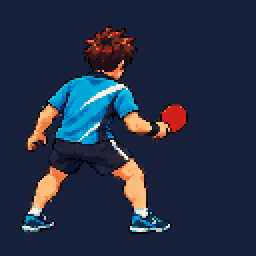
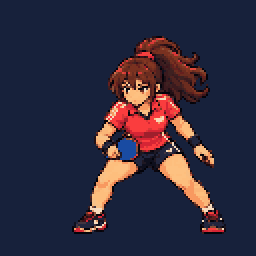
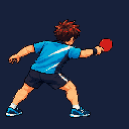
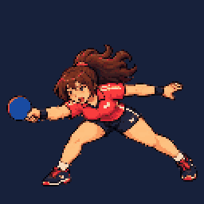

# 128×128 캐릭터 애니메이션

승인된 v3 방향으로 제작한 플레이어/상대의 **Idle 4 + Swing 6 + Miss 4**, 총 28프레임이다. 아래 GIF는 확인용 2배 Nearest 확대이며 실제 프레임은 128×128이다. 각 GIF는 게임의 프레임 속도(4/20/10fps)를 반영하며 반복 표시한다. 게임에서 Swing/Miss는 한 번 재생하고 Idle로 복귀한다.

| 동작 | 플레이어 | 상대 |
|---|---|---|
| Idle |  |  |
| Swing |  |  |
| Miss |  |  |

각 역할의 `preview.gif`는 세 동작 비교용이며 게임 재생 속도를 표현하지 않는다.

[게임 접촉 화면](../../docs/previews/characters-in-game.png) / [Miss 화면](../../docs/previews/character-miss.png) / [검증 기록](../../docs/PHASE4_CHARACTER_VALIDATION.md)

시트는 Idle/Miss 512×128, Swing 768×128, RGBA PNG, 역할별 32색과 alpha 0/255를 사용한다. 모든 프레임의 발 하단은 y116이며, 역할별 고정 피벗은 플레이어 (48,116), 상대 (74,116)이다. 접촉 프레임은 0부터 세어 3번이며 라켓 접촉 좌표는 각각 (112,44)/(31,54)다. `frames.tres`와 `manifest.json`에 속도·영역·기준점·원본 영역·해시를 기록했다.

사용자가 Python 규격화를 허용했다. 생성 원본을 보존하고 연결된 실루엣 분리, Nearest 축소, 투명 경계 정리, 팔레트 제한을 적용했다. 생성 프레임의 자세/체형 연속성과 실제 모바일 가독성은 수동 검수 대기다. PerfectSwing/Hit/Victory/Defeat 및 환경/UI/효과는 미완료이며 이번 화면은 캐릭터만 연결한 중간 결과다.
