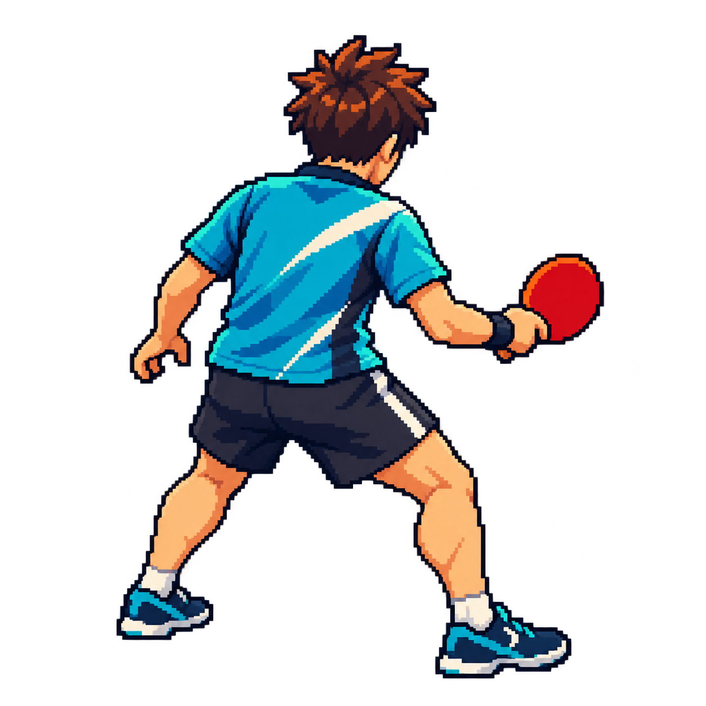
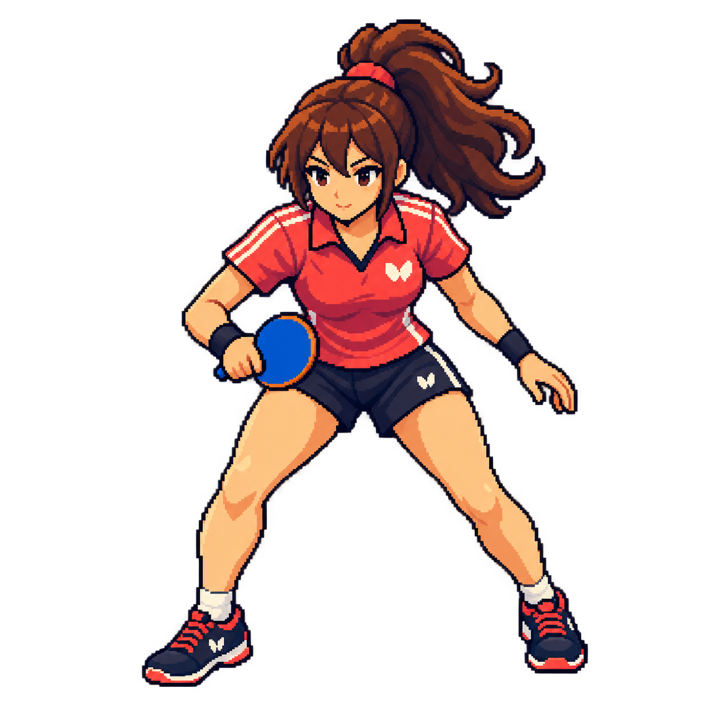

# 캐릭터 기본 포즈 원본

사용자의 직접 에셋 제작 요청에 따라 승인된 focused-court-v3 시안에서 캐릭터 디자인을 제작했다. 원본 디자인은 수동 검토 대기이며 파생 128×128 Idle/Swing/Miss는 제작·자동 규격 검사·게임 연결을 마쳤다.

| 플레이어: 후방 대각선, 청록 유니폼/붉은 라켓 | 상대: 정면 대각선, 붉은 유니폼/푸른 라켓 |
|---|---|
|  |  |

각 파일은 실제 **1254×1254 RGBA PNG**이며 투명 영역/캐릭터 불투명 영역이 확인되었다. 배경처럼 보이는 검은색은 뷰어의 투명 배경 표시일 수 있다. 캐릭터 주요 실루엣은 파일 안에 여백을 두고 들어간다. 플레이어 원본 테두리에 alpha=1 잔여 픽셀이 있어 최종 규격화 때 정리해야 한다.

이 파일은 캐릭터의 외형/색상/방향/라켓을 정하는 고해상도 기준 원본이다. 최종 128셀의 도트 그리드, 투명 경계, 피벗, 프레임 정렬을 검증하지 않았다. 이 기본 포즈 원본 자체는 게임 씬에 연결하지 않는다. 별도 애니메이션 원본과 파생 결과를 아래에 기록한다.

`player_animation_source.png`와 `enemy_animation_source.png`는 1774×887 RGBA 생성 원본이다. 원본은 정확한 128셀 그리드가 아니다. 사용자 허용에 따라 Python으로 원본을 보존하면서 실루엣 분리·Nearest 크기 조정·투명 경계를 정리해 [실제 128셀 애니메이션](../../characters/README.md)을 만들었다. 기본 참조 이미지와 애니메이션 생성 원본은 Godot import/export에서 제외한다 (`assets/source/.gdignore`).

`player_drive_source.png`는 오른손 포핸드 드라이브 Swing 6프레임의 생성 원본이다. `tools/assets/build_player_drive.py`가 원본을 보존한 채 정확한 128×128 프레임으로 규격화한다. 현재 게임의 플레이어 Swing에 연결되어 있으며 실제 모바일 동작 검수는 남아 있다.
