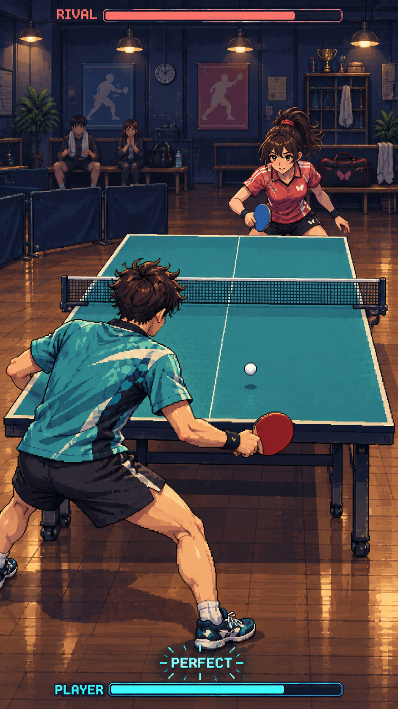
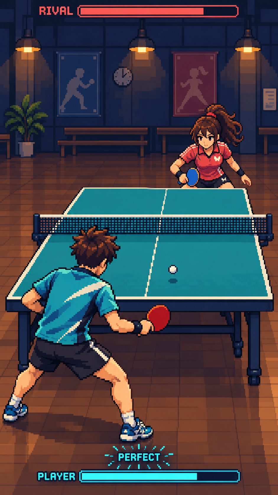

# 게임 화면 시안

사용자가 요청한 세밀한 도트 스타일의 첫 전체 화면 시안이다. 아직 디자인 승인/게임 에셋 분리/실제 통합을 진행하지 않았다.

청록색 플레이어/탁구대, 붉은 상대, 따뜻한 조명의 실내 경기장 구성을 검토한다. 이 PNG는 전체 분위기와 구도 검토용이며 실제 Godot 화면 캡처가 아니다. 현재 실행 게임에는 적용하지 않았다. 확정 후 픽셀 규격/라켓 접촉점/레이어/개별 스프라이트를 제작·검증한다.

## 128×128 캐릭터 방향의 두 번째 시안

사용자 요청으로 기존 구도와 색감을 유지하면서 배경 소품/옷 디테일을 줄이고 도트 군집을 더 크게 정리했다. 전체 화면 시안이며 정확한 128×128 셀/스프라이트 시트는 아니다. 실제 에셋은 방향 승인 후 픽셀 그리드/셀 크기/투명 배경을 별도로 제작·검증한다. 게임 내부 해상도와 현재 실행 에셋은 변경하지 않았다.
